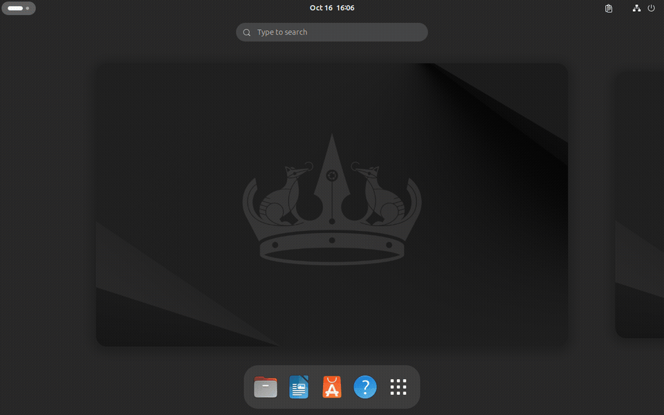
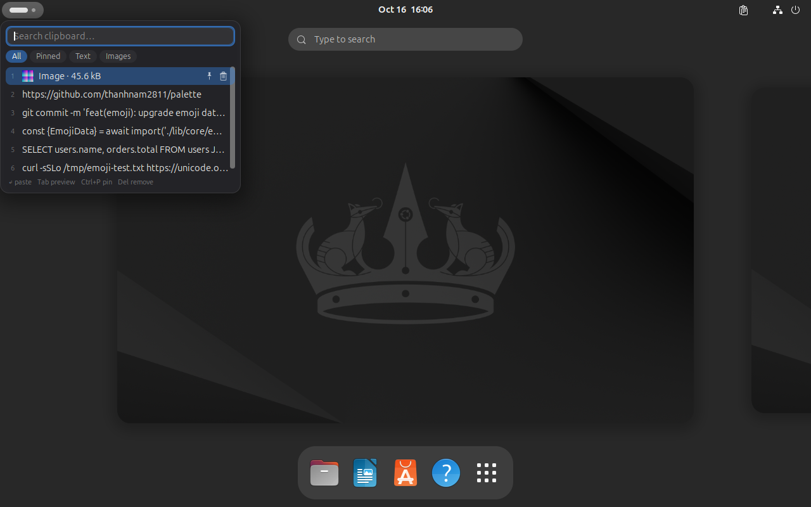
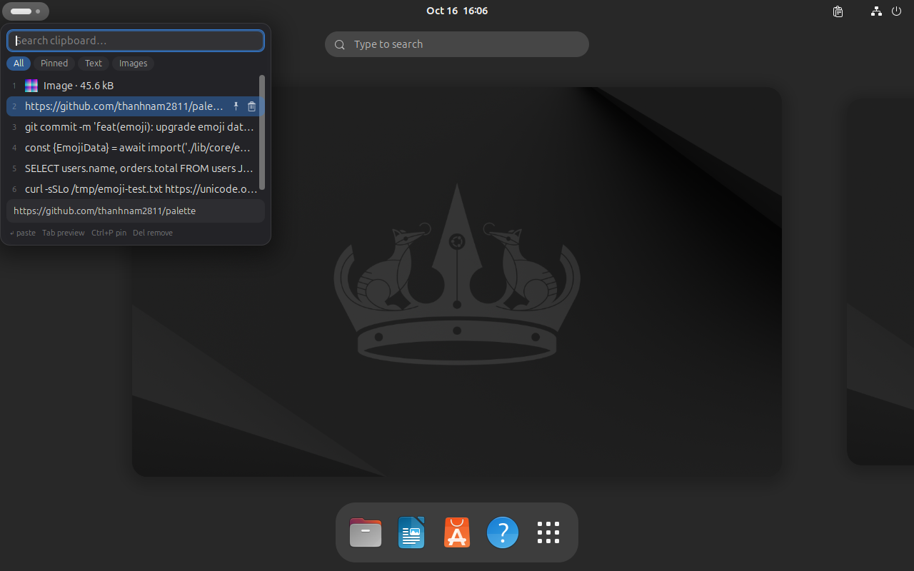
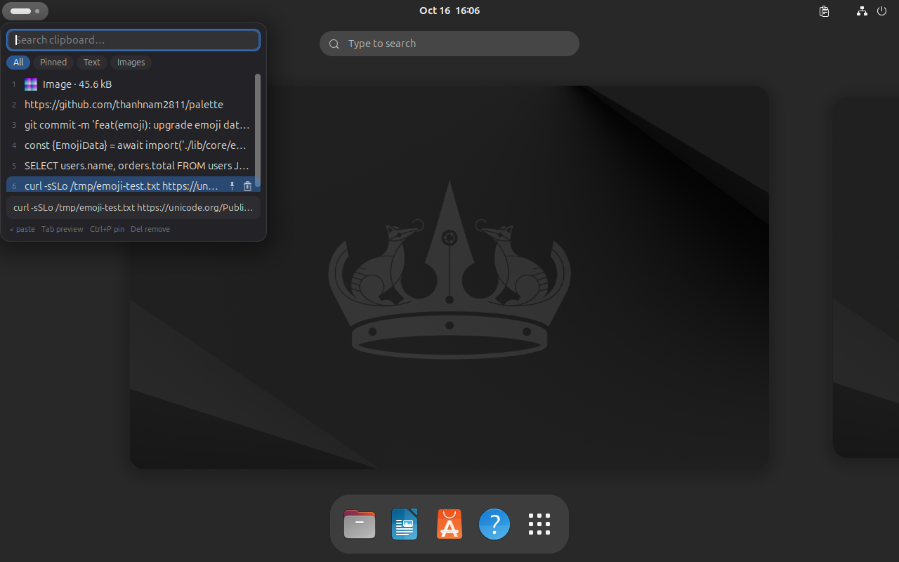
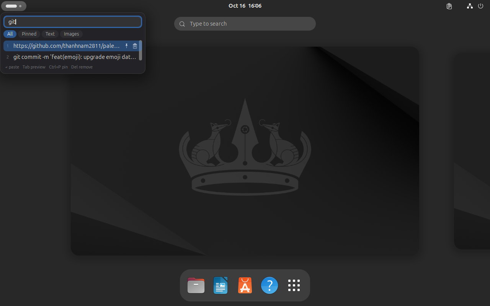
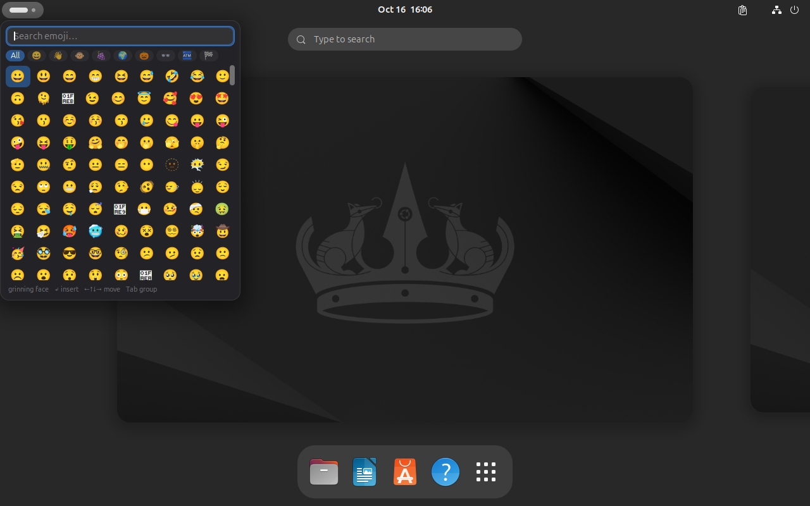
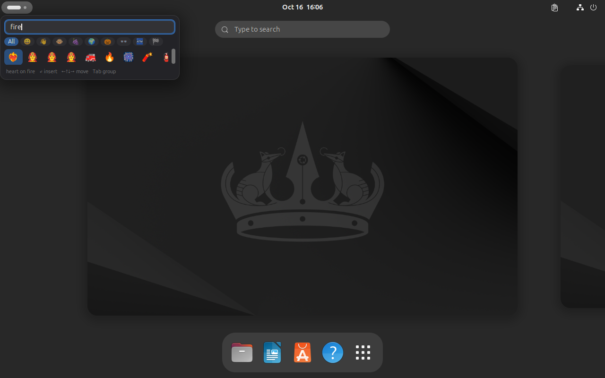

# Palette

A fast, compact clipboard history for GNOME Shell 46 (Wayland): a floating
palette at your cursor that pastes back into whatever you were doing.



> Status: personal project, tested on GNOME Shell 46 / Wayland only, not yet on
> extensions.gnome.org. Clipboard history and the emoji picker live in the same
> popup — see [Roadmap](#roadmap) for what is left.

## Features

- **Text and images** from the clipboard, deduplicated by content hash: copying
  the same thing again only bumps its position.
- **Emoji picker** in the same popup (`Super`+`.`, like Windows' `Win`+`.`):
  1923 emoji from Unicode 18.0, search by name, filter by group.
- **Instant search** over the whole history, keyboard-first.
- **Pinning** for entries that must survive eviction.
- **Compact popup** at the pointer (or centred), with an optional preview pane.
- **Private-mode friendly**: private mode, per-app exclusion, and password
  managers' `x-kde-passwordManagerHint` are honoured.
- **Cheap by construction**: opening the popup costs ~2 ms whether the history
  holds 50 or 500 entries, and image rows draw a 128px thumbnail instead of
  decoding the full photo — see [docs/BENCH.md](docs/BENCH.md).

## Screenshots

| Clipboard History | Image Preview Pane |
|:---:|:---:|
|  |  |
| **Multi-line Text Preview** | **Quick Search** |
|  |  |

| Emoji Picker (Unicode 18.0) | Emoji Search & Filter |
|:---:|:---:|
|  |  |

## Requirements

GNOME Shell 46, Wayland or X11. No runtime dependencies beyond the shell itself:
the emoji list is generated from the Unicode `emoji-test.txt` (`unicode-data` on
Debian/Ubuntu) by `scripts/gen-emoji.js` and committed as
`extension/data/emoji.json`, and thumbnails use GdkPixbuf, which the shell already
loads.

## Install

Until it is published on [extensions.gnome.org](https://extensions.gnome.org/):

```sh
scripts/pack.sh
gnome-extensions install --force palette@namtt.shell-extension.zip
gnome-extensions enable palette@namtt
```

On Wayland, GNOME Shell cannot reload an already-loaded extension: **log out and
back in** after installing or updating, then enable *Palette* in the Extensions
app (or with the `gnome-extensions enable` command above).

## Usage

`Super+V` (configurable) opens the clipboard history at the pointer and takes
the keyboard. Choosing an entry puts it on the clipboard and — unless
`paste-on-select` is off — sends `Ctrl+V` (`Ctrl+Shift+V` in the apps listed
under *Terminal apps*) to the focused window.

`Super+.` (configurable) opens the emoji picker in the same popup. Typing filters
by name as you type; exact and whole-word matches come first, so `cake` finds
`birthday cake` before `pancakes`. `Enter` or a click appends the selected emoji
to a run in the bar at the bottom, so several can be chained like `Win`+`.`
without losing the search. `Tab` walks search → run → `Paste`; the run is a real
text field, so `Tab` into it to delete or edit what you collected, then `Tab` on
to `Paste`. `Esc`, a click outside, or `Enter` on `Paste` inserts the run and
closes; with an empty run they just close.

| Key | Clipboard history | Emoji picker |
|-----|-------------------|--------------|
| `↑` `↓` | Move one entry | Move one row |
| `←` `→` | Move the search caret | Move one emoji |
| `Page Up` `Page Down` | Move a page | Move a page |
| `Enter` | Paste the selected entry | Add the selected emoji to the run (on `Paste`: insert the run) |
| `Alt+1` … `Alt+9` | Paste the n-th visible entry | — |
| `Ctrl+1` … `Ctrl+4` | Filter: All / Pinned / Text / Images | — |
| `Ctrl+1` … `Ctrl+9` | — | Jump to the n-th emoji group |
| `Tab` / `Shift+Tab` | Toggle the preview pane | Focus search → run → `Paste` |
| `Ctrl+P` | Pin or unpin the selected entry | — |
| `Delete` | Remove the selected entry | — |
| type any text | Search the history | Search emoji by name |
| `Esc` or click outside | Close without pasting | Insert the run, then close |

The panel icon opens the palette and a small menu: private mode, clear history,
preferences.

## Configuration

Preferences are in the Extensions app (*Palette* → Settings), stored in GSettings
under `org.gnome.shell.extensions.palette`. The two shortcut rows record the keys
you actually press: click the row, press the combination, `Backspace` clears it.

| Key | Default | Meaning |
|-----|---------|---------|
| `toggle-shortcut` | `<Super>v` | Accelerator that opens the clipboard history |
| `emoji-shortcut` | `<Super>period` | Accelerator that opens the emoji picker |
| `history-size` | `50` | Entries kept (pinned entries are not counted) |
| `max-text-kb` | `1024` | Largest text stored, in KB |
| `max-image-mb` | `8` | Largest image stored, in MB (`0` stops recording images) |
| `max-total-mb` | `256` | Total size of stored long texts and images, in MB (pinned entries are never evicted, so they can exceed it) |
| `popup-position` | `cursor` | `caret` (text cursor of the focused window, falls back to `cursor` when the app reports none), `cursor` or `center` |
| `density` | `compact` | `compact` (24px rows, 12px labels) or `comfortable` (28px rows) |
| `paste-on-select` | `true` | Send the paste shortcut after choosing an entry |
| `private-mode` | `false` | Stop recording the clipboard |
| `capture-on-start` | `false` | Also record what is already on the clipboard when the extension starts |
| `excluded-apps` | `[]` | Window classes whose copies are never recorded |
| `terminal-apps` | list | Window classes that paste with `Ctrl+Shift+V` |
| `show-indicator` | `true` | Show the panel icon |

## Privacy

- Nothing leaves the machine; the extension makes no network requests.
- Private mode, excluded apps and password-manager hints keep secrets out of the
  history. Private mode is also honoured for a copy that is already being read
  when it is switched on.
- Content that was already on the clipboard when the extension starts is not
  recorded unless `capture-on-start` is enabled (off by default).
- Data lives in `~/.local/share/palette` (`history.log` plus `blobs/`), files
  `0600` inside a `0700` directory. Deleting that directory clears everything.

## Development

```sh
gjs -m test/run.js        # unit tests: store, codec, search, text, emoji
scripts/dev-shell.sh      # isolated headless GNOME Shell running the extension
scripts/dev-restart.sh    # (re)start that shell in the background
scripts/pack.sh           # build palette@namtt.shell-extension.zip
```

`scripts/dev.sh` drives the dev shell over D-Bus (`dev_eval`, `dev_shot`,
`dev_keys`); `bench/` holds the benchmarks behind the decisions in
[docs/BENCH.md](docs/BENCH.md). Layout, data model and design decisions are in
[docs/ARCHITECTURE.md](docs/ARCHITECTURE.md); contribution notes in
[CONTRIBUTING.md](CONTRIBUTING.md).

## Roadmap

- Recently used emoji first; the 1923 base emoji of Unicode 18.0 are shipped,
  skin-tone variants are not.
- Known limitation: no `text/html`, no PRIMARY selection, no sync/tags/export
  (see the non-goals in the architecture doc).

## Credits

The idea of a searchable clipboard history was inspired by
[Clipboard Indicator](https://github.com/Tudmotu/gnome-shell-extension-clipboard-indicator)
and [Clipboard History](https://github.com/SUPERCILEX/gnome-clipboard-history)
(both MIT). No code is shared with either: syntax, storage and UI were written
from scratch for this extension.

## License

MIT — see [LICENSE](LICENSE).
