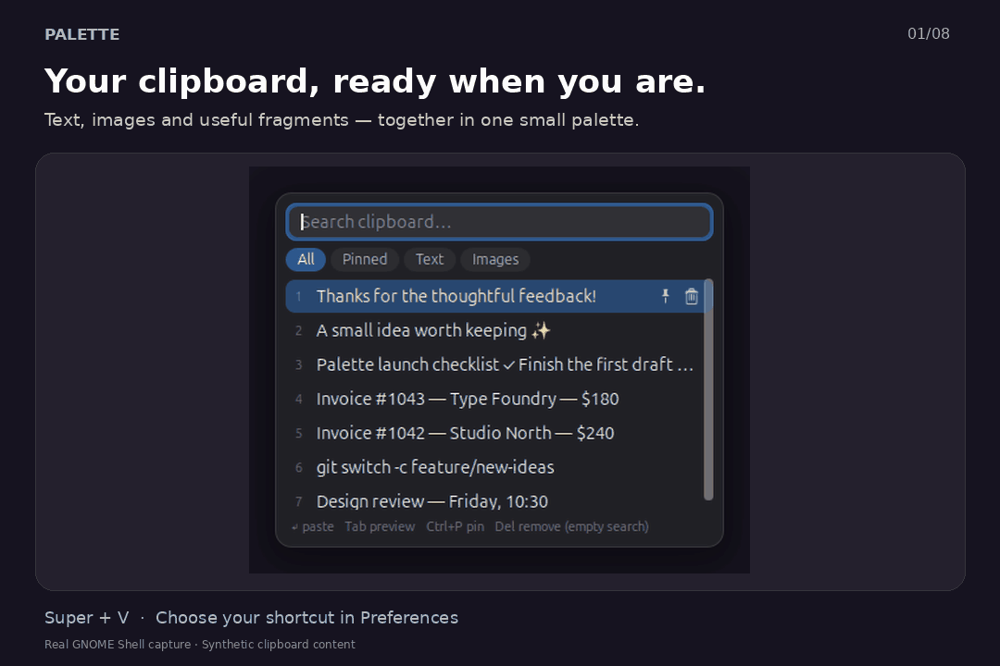
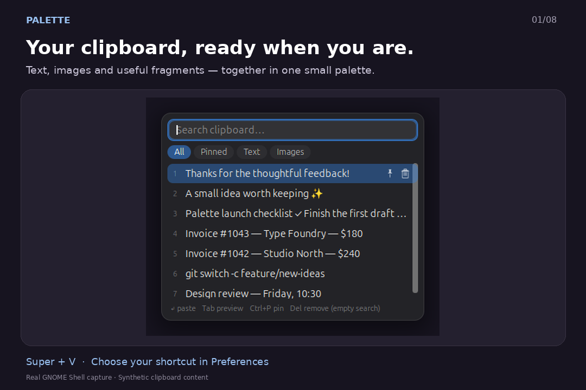
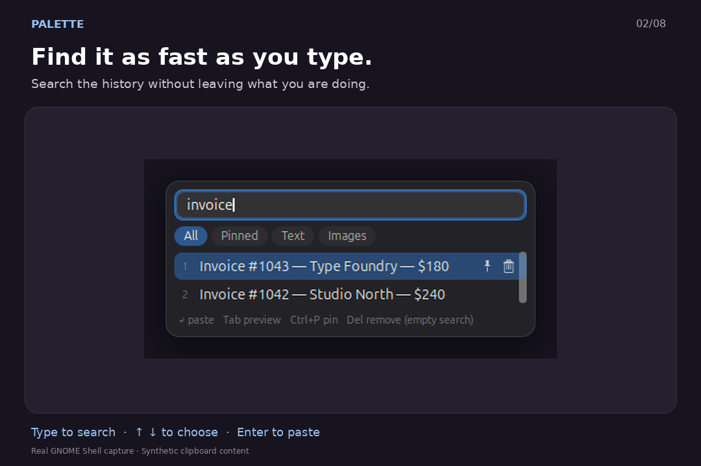
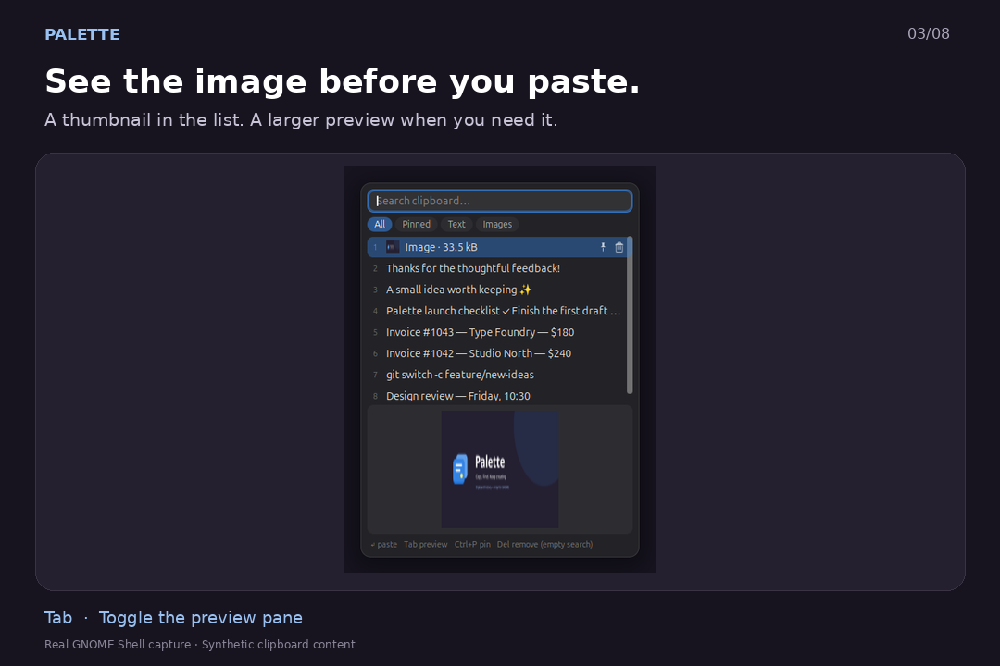
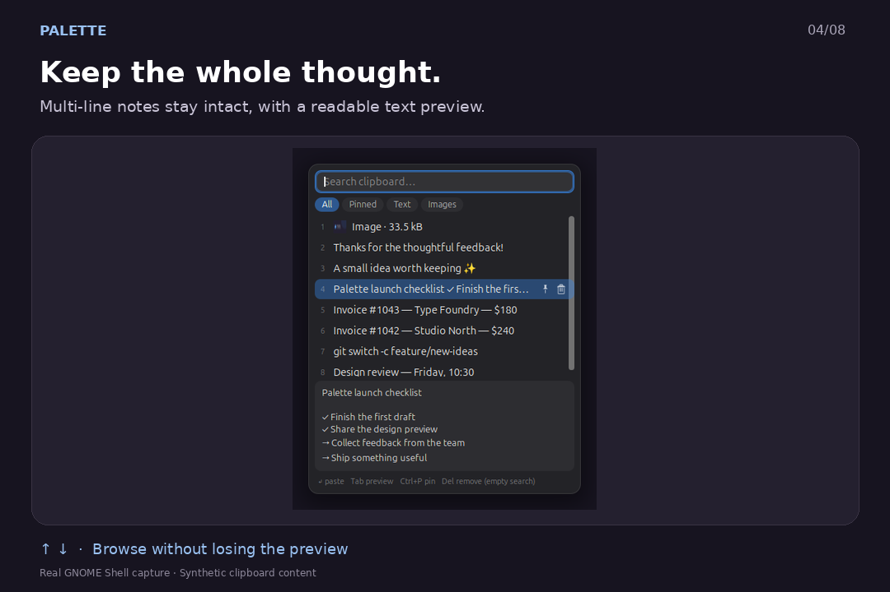
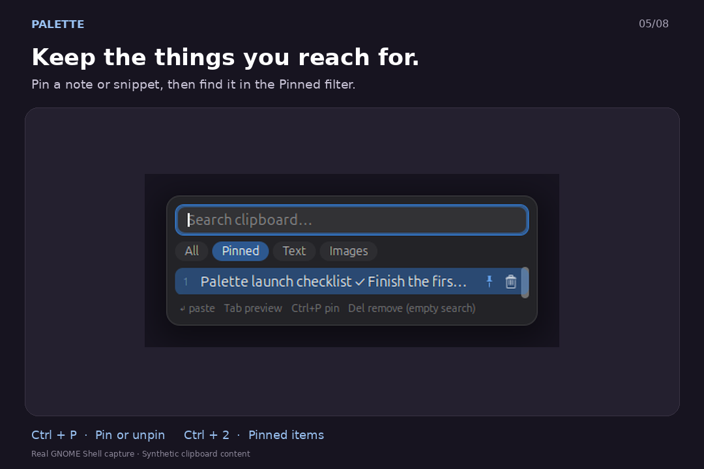
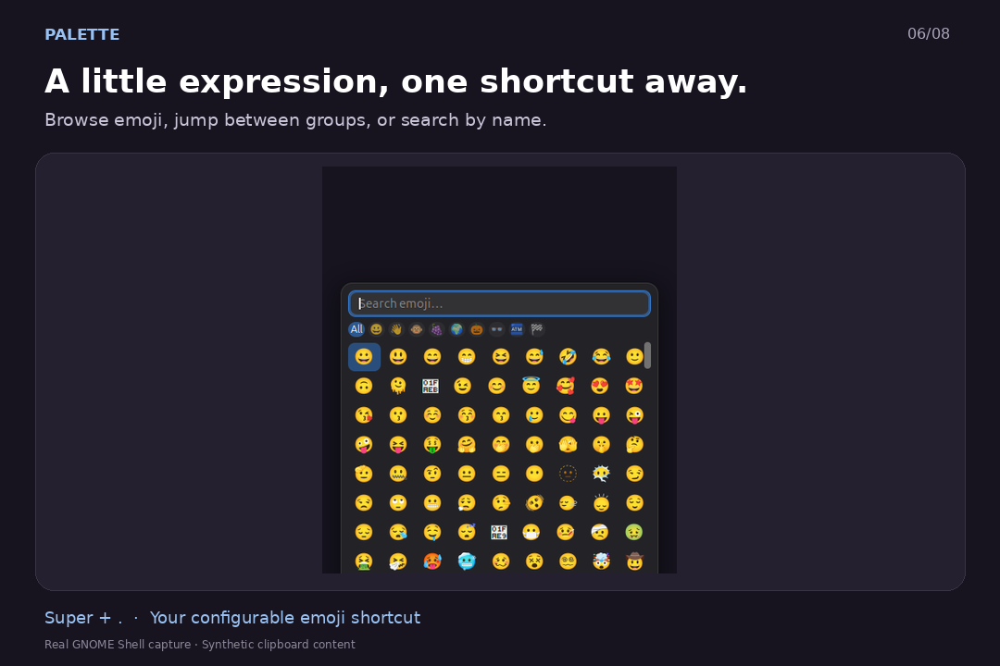
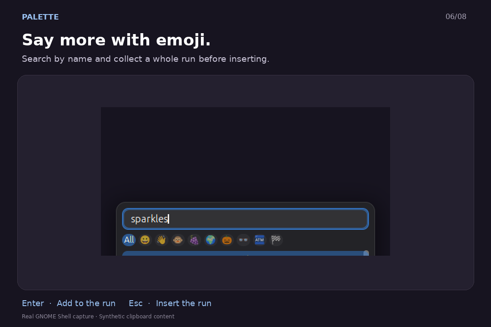
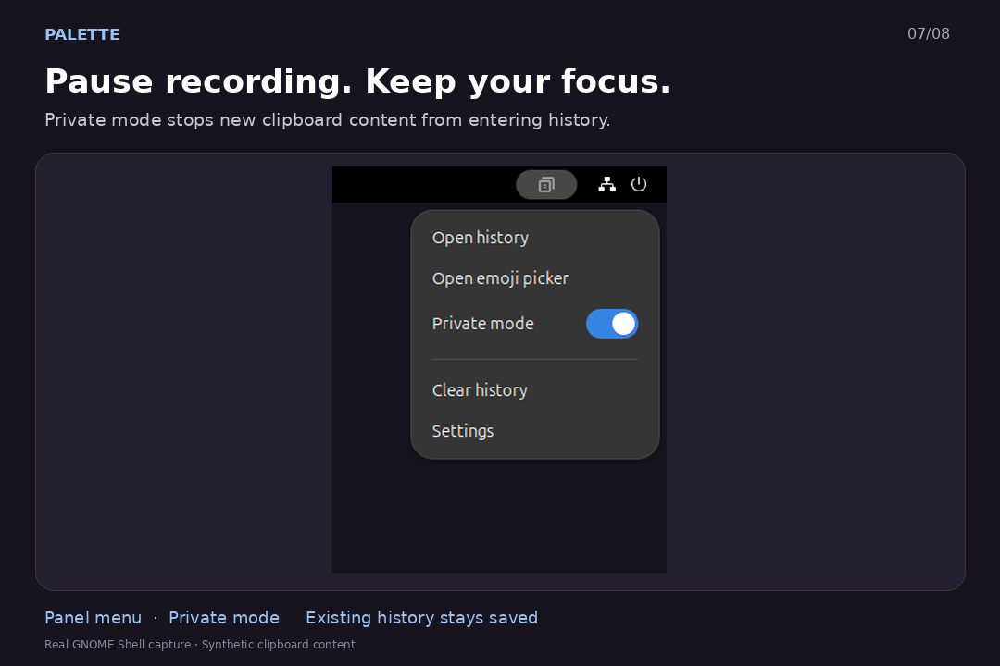
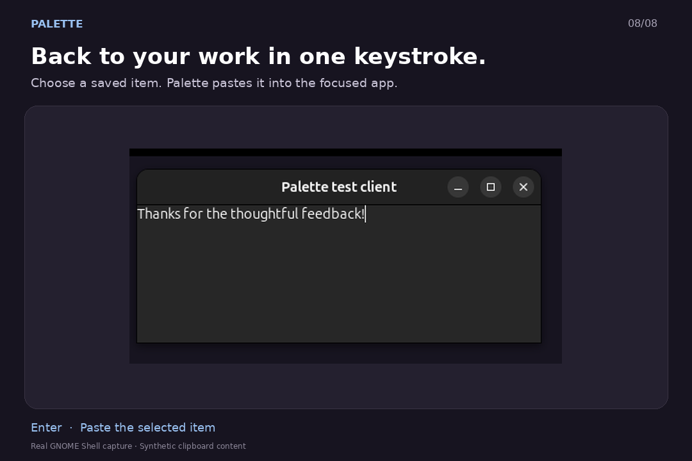

# Palette in action



[Watch/download the MP4](palette-demo.mp4). The animation uses real GNOME Shell
46 captures from an isolated Wayland session, with cropping and explanatory
captions. Configured shortcuts are shown; new installations start without
shortcuts. Every clipboard item shown was created specifically for this demo.

| Clipboard history | Instant search |
| --- | --- |
|  |  |
| Image preview | Multi-line text preview |
|  |  |
| Pin and filter | Emoji browser |
|  |  |
| Build an emoji run | Private mode |
|  |  |



The paste scene verifies that the selected history item arrives in a real GTK
text view. The capture script also checks pinned content, the exact `🚀✨` emoji
run, and that private-mode content does not enter the history. Private mode does
not erase saved history or clear the system clipboard.

[Original full-screen captures](screenshots/raw/) are unmodified; the gallery
adds cropping, headings and hints outside the captured UI. The capture manifest
is [capture.json](capture.json). [Light preferences](screenshots/raw/preferences-light.png)
shows the native settings window separately from the walkthrough.

To regenerate, start a fresh isolated session and run:

```sh
scripts/dev/session.sh
python3 scripts/make-demo.py /tmp/palette-session.XXXXXX
```

Capture dependencies: Pillow, DejaVu Sans, and ffmpeg, in addition to the
[GNOME testing prerequisites](../TESTING.md). These are development tools,
not runtime dependencies of the extension. The script refuses host installation
paths and only clears the synthetic history in its explicitly isolated session.
